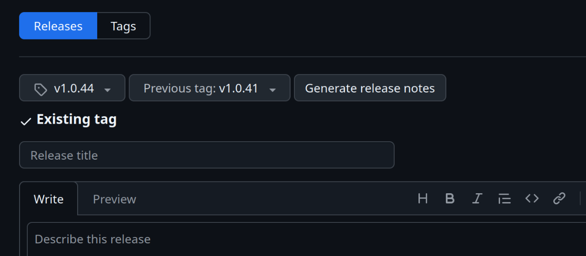

# Deployment Guide

This guide describes the deployment process across all environments in our CI/CD pipeline.

## Environments

We maintain 5 environments in our deployment pipeline:

| Environment | Branch                                                                                                   | Purpose                 | Notes                           |
| ----------- | -------------------------------------------------------------------------------------------------------- | ----------------------- | ------------------------------- |
| `sandbox`   | `sandbox`                                                                                                | Development testing     | Primary development environment |
| `dev`       | None (Promote workflow)                                                                                  | Development             | Promoted from sandbox           |
| `test`      | None (Promote workflow)                                                                                  | Testing                 | Promoted from dev               |
| `uat`       | None (Promote workflow)                                                                                  | User Acceptance Testing | Promoted from test              |
| `prod`      | None (deployed using [GitHub Releases](https://github.com/department-for-transport-BODS/abods/releases)) | Production              | Live environment                |

## Deployment to Sandbox

The sandbox branch is the default branch and our primary development branch. Merging a pull request triggers **build on merge**, which builds artefacts in `bods-artefact-store` and deploys them using **deploy artefacts**. Increment [VERSION](../VERSION) before merging. The sandbox-only manual **deploy artefacts** workflow can also redeploy matching backend and frontend artefacts.

> [!IMPORTANT]
> Database migrations will not be applied automatically in sandbox - you must connect to the database and run changes manually

### Test a feature branch before review

1. Push your feature branch.
2. Open [build application](https://github.com/department-for-transport-BODS/abods/actions/workflows/build.yml), select **Run workflow**, choose your feature branch and start the build.
3. After the build succeeds, [deploy sandbox](https://github.com/department-for-transport-BODS/abods/actions/workflows/deploy-sandbox.yml) automatically updates sandbox with your changes.
4. Wait for deployment to succeed, then test your feature in sandbox.

No separate deployment, Git tag or [VERSION](../VERSION) change is required. This only applies to manually started feature-branch builds; `dev`, `test` and `main` are excluded.

> [!WARNING]
>
> Sandbox is shared, so coordinate with the team before replacing it. Feature deployments do not update the artefact manifest. Restore sandbox through a new successful **build on merge** deployment before promoting; redeploying the artefacts already recorded in the manifest will be skipped.

## Standard Deployment Process (Path to Live)

### Promote to DEV, TEST and UAT

1. Open the [Promote workflow](https://github.com/department-for-transport-BODS/abods/actions/workflows/promote.yml) and select **Run workflow** on the default branch.
2. Select **Target environment**: `dev`, `test` or `uat`.
3. Approve the target GitHub environment deployment if approval is required.
4. Wait for success before promoting to the next environment.

Promotion follows `sandbox -> dev -> test -> uat`. The workflow reads the preceding environment's deployed backend and frontend artefact identifiers from `bods-artefact-manifest`; it does not select a version from the checked-out branch or rebuild application code. Both components must have matching versions and build commits.

Artefacts are copied from `bods-artefact-store` into the target environment's `DEPLOYMENT_ARTEFACTS_S3_BUCKET`, including packaged backend objects. The SAM template is updated to reference that bucket. Frontend runtime configuration is generated using the target environment's SSM parameters and GitHub configuration. The backend and frontend are deployed and the CloudFront cache is invalidated before the target's DynamoDB manifest entries are updated together.

Promotion deploys the same release version to each environment without rebuilding it. The SAM template is updated to use the target environment's S3 deployment bucket, and the frontend runtime configuration is generated for that environment.

Each target GitHub environment must provide `AWS_ACCOUNT_ID`, `AWS_ASSUME_ROLE_NAME`, `DEPLOYMENT_ARTEFACTS_S3_BUCKET`, `DEPLOYMENT_ARTEFACTS_KMS_KEY_ID`, `PROJECT_NAME`, `MAPBOX_STYLE` and `MAPBOX_SATELLITE_STYLE`, plus the `MAPBOX_TOKEN` and `ANALYTICS_ID` secrets. The repository must provide `AWS_REGION` and the `ARTEFACT_STORE_ROLE_ARN` secret. The artefact-store role needs S3/KMS read access and DynamoDB read/write access in `eu-west-2`; target roles need deployment-bucket S3/KMS access and the existing SAM, SSM and CloudFront permissions.

`sandbox` and production are not promotion targets. The legacy **deploy application** workflow now handles production only; branch pushes and `automated-deploy-dev` dispatches no longer deploy non-production environments. Existing build workflows are unchanged, and manual deployments through **deploy artefacts** remain sandbox-only.

#### Deploy to DEV

After UAT approval, merge the approved sandbox code into the `dev` branch to build production release artefacts. This step does not deploy to the DEV environment; use the Promote workflow above for that.

1. Ensure the [VERSION](../VERSION) has not already been used for a release build.
2. Create a [sandbox → dev PR](https://github.com/department-for-transport-BODS/abods/compare/dev...sandbox?quick_pull=1&title=sandbox+-%3E+dev).
3. Wait for checks to pass.
4. **Merge offline** using:

   ```bash
   # Save any local changes
   git stash push -m "Unfinished changes before deploy"

   # Update dev branch
   git checkout dev
   git pull
   git fetch
   git merge origin/sandbox
   git push
   ```

> [!IMPORTANT]
>
> Wait for the **build application** workflow to complete before deploying to production. It creates the production deployment artefacts and a tag based on the [VERSION](../VERSION) file.

#### Deploy to PRODUCTION

> [!IMPORTANT]
>
> - Complete a team go/no-go discussion before production deployment
> - Production continues to use legacy release artefacts and version tags created by the existing dev-branch **build application** workflow. Promotion does not create these artefacts or tags.

1. Complete **Deploy to DEV** above and wait for the production artefacts and version tag to be created successfully.
2. Create a [new GitHub release](https://github.com/department-for-transport-BODS/abods/releases/new) from that tag.
3. Select the [latest release](https://github.com/department-for-transport-BODS/abods/releases/latest) as the previous tag and click "Generate release notes".
4. Publish the release and approve the [deployment workflow](https://github.com/department-for-transport-BODS/abods/actions/workflows/deploy.yml).



## Hotfix deployment override (DEV, TEST and UAT)

Use **Hotfix** only when an explicitly selected release must bypass normal promotion from the preceding environment. It supports `dev`, `test` and `uat`, the same targets as **Promote**. It is manual-only and is not triggered by builds, merges or repository dispatches. For production emergencies, follow [Production Hotfixes](#production-hotfixes) below.

### Prerequisites

- The release must have an existing Git tag in `vX.Y.Z` format pointing to the commit used to build its artefacts. Both lightweight and annotated tags are supported.
- Matching `abods_backend_vX.Y.Z` and `abods_frontend_vX.Y.Z` artefacts must already exist in `bods-artefact-store`, including `build-info.json`, as produced by **build on merge**. Hotfix does not build code, create tags or convert legacy **build application** artefacts.
- The target must have the configuration and AWS permissions described under **Promote to DEV, TEST and UAT**.

> [!IMPORTANT]
>
> Hotfix deployments to `dev`, `test` and `uat` require approval through the target environment's existing approval gate before any deployment changes occur.

### Prepare a Hotfix release

1. Make the hotfix changes and increment [VERSION](../VERSION) to an unused release version.
2. Merge the changes into `sandbox` and wait for **build on merge** to succeed.
3. Create and push a Git tag matching that version, pointing to the exact sandbox commit built by that workflow. **build on merge** does not create the tag automatically.

   Copy the commit SHA from the successful **build on merge** run, then run:

   ```bash
   git fetch origin --tags
   git tag -a v1.2.3 <built-commit-sha> -m "Release v1.2.3"
   git push origin refs/tags/v1.2.3
   ```

   Replace `v1.2.3` with the version in [VERSION](../VERSION) at that commit, and `<built-commit-sha>` with the copied SHA. Do not assume the latest sandbox commit is still the one built, and do not move or overwrite an existing tag. Pushing the tag does not deploy it.

4. Follow **Run a Hotfix** below to deploy directly to `dev`, `test` or `uat`, without first deploying to preceding environments.

A separate hotfix build workflow is not required for this path. A feature-branch build through **build application** alone is not sufficient because it produces legacy artefacts.

> [!WARNING]
>
> The deployment includes the entire tagged sandbox build, including any other changes already merged into sandbox, not just the hotfix. Check that all included changes are suitable for the target environment. Production is not a target of this workflow.

### Run a Hotfix

1. Open the [Hotfix workflow](https://github.com/department-for-transport-BODS/abods/actions/workflows/hotfix.yml) and select **Run workflow** on the default branch.
2. Enter the existing release **tag**, for example `v1.1.20`, and select the target **environment**.
3. The workflow rejects unsupported targets and invalid or missing tags, then calls the existing **deploy artefacts** workflow with the selected release's backend and frontend prefixes. It does not read the preceding environment's manifest to choose a version.
4. An authorised reviewer approves the target environment deployment. All artefact replication and deployment changes occur inside the protected deployment job, after approval.
5. The deployment verifies that both artefacts match the tag's commit, retargets the backend and frontend configuration, deploys both components and invalidates CloudFront. After success, the existing deploy flow updates both entries in the target environment's `bods-artefact-manifest` together.

If the target already records both requested artefacts, the existing deploy flow skips deployment. Missing artefacts or mismatched build metadata fail the workflow rather than selecting another release. A failed deployment does not update the manifest.

No branch reset or force-push is needed for these non-production deployments. Build automation and the standard promotion workflow are unchanged. This workflow does not replace the production hotfix procedure below.

## Production Hotfixes

Use the existing production hotfix procedure in emergencies when the regular path to live contains code not ready for production. The **Hotfix** workflow above does not target production.

> [!WARNING]
>
> - Use hotfixes only when necessary - prefer fixing forward whenever possible
> - Requires permission to force push the dev branch
> - This process may impact development work

### Create and Implement Hotfix

1. Create a hotfix branch from the latest production tag:
   ```bash
   git stash push -m "Unfinished changes before hotfix"
   git fetch
   git checkout -b hotfix/my-hotfix-branch-name vx.y.z
   ```
2. Make required changes to fix the issue
3. **Important:** Update the [VERSION](../VERSION) file to a version higher than current dev
4. Follow normal development practices, but don't merge the PR yet

### Generate Deployment Assets

1. Save the current state of the dev branch:
   ```bash
   git fetch
   git checkout -b DEV-BRANCH-BEFORE-HOTFIX-DEPLOYMENT origin/dev
   git push -u origin DEV-BRANCH-BEFORE-HOTFIX-DEPLOYMENT
   ```
2. Force-push the hotfix to dev:
   ```bash
   git checkout dev
   git reset --hard hotfix/my-hotfix-branch-name
   git push --force-with-lease
   ```

This will trigger the [build workflow](https://github.com/department-for-transport-BODS/abods/actions/workflows/build.yml) and create properly tagged assets for production.

### Deploy Hotfix to Production

Follow the regular [Deploy to PRODUCTION](#deploy-to-production) steps above.

### Cleanup After Hotfix

1. Merge your hotfix PR into the sandbox branch
2. Restore the dev branch to its previous state:
   ```bash
   git checkout dev
   git reset --hard DEV-BRANCH-BEFORE-HOTFIX-DEPLOYMENT
   git push --force-with-lease
   git push origin --delete DEV-BRANCH-BEFORE-HOTFIX-DEPLOYMENT
   ```
