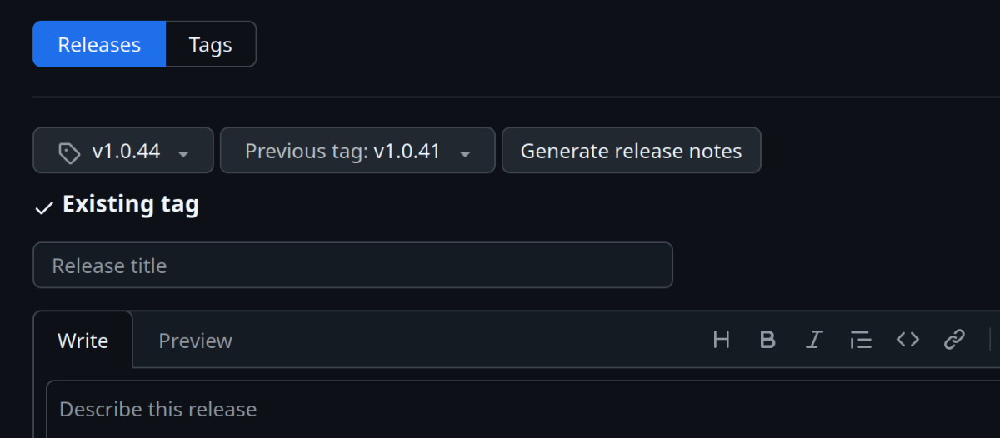

# Deployment Guide

This guide describes the deployment process across all environments in our CI/CD pipeline.

## Environments

We maintain 5 environments in our deployment pipeline:

| Environment | Branch                                                                                                   | Purpose                 | Notes                           |
| ----------- | -------------------------------------------------------------------------------------------------------- | ----------------------- | ------------------------------- |
| `sandbox`   | `sandbox`                                                                                                | Development testing     | Primary development environment |
| `dev`       | None (Promote workflow)                                                                                  | Development             | Promoted from sandbox           |
| `test`      | None (Promote workflow)                                                                                  | Testing                 | Promoted from dev               |
| `uat`       | None (Promote workflow)                                                                                  | User Acceptance Testing | Promoted from test              |
| `prod`      | None (deployed using [GitHub Releases](https://github.com/department-for-transport-BODS/abods/releases)) | Production              | Live environment                |

## Deployment to Sandbox

The sandbox branch is the default branch and our primary development branch. Merging a pull request triggers **build on merge**, which builds artefacts in `bods-artefact-store` and deploys them using **deploy artefacts**. Increment [VERSION](../VERSION) before merging. The sandbox-only manual **deploy artefacts** workflow can also redeploy matching backend and frontend artefacts.

> [!IMPORTANT]
> Database migrations will not be applied automatically in sandbox - you must connect to the database and run changes manually

## Standard Deployment Process (Path to Live)

### Promote to DEV, TEST and UAT

1. Open the [Promote workflow](https://github.com/department-for-transport-BODS/abods/actions/workflows/promote.yml) and select **Run workflow** on the default branch.
2. Select **Target environment**: `dev`, `test` or `uat`.
3. Approve the target GitHub environment deployment if approval is required.
4. Wait for success before promoting to the next environment.

Promotion follows `sandbox -> dev -> test -> uat`. The workflow reads the preceding environment's deployed backend and frontend artefact identifiers from `bods-artefact-manifest`; it does not select a version from the checked-out branch or rebuild application code. Both components must have matching versions and build commits.

Artefacts are copied from `bods-artefact-store` into the target environment's `DEPLOYMENT_ARTEFACTS_S3_BUCKET`, including packaged backend objects. The SAM template is updated to reference that bucket. Frontend runtime configuration is generated using the target environment's SSM parameters and GitHub configuration. The backend and frontend are deployed and the CloudFront cache is invalidated before the target's DynamoDB manifest entries are updated together.

The manifest retains the original artefact identifiers, including their build-environment prefix, so subsequent promotions use the same immutable source artefacts. A failed deployment does not advance the manifest; inspect or rerun the deployment if infrastructure was partially updated.

Each target GitHub environment must provide `AWS_ACCOUNT_ID`, `AWS_ASSUME_ROLE_NAME`, `DEPLOYMENT_ARTEFACTS_S3_BUCKET`, `DEPLOYMENT_ARTEFACTS_KMS_KEY_ID`, `PROJECT_NAME`, `MAPBOX_STYLE` and `MAPBOX_SATELLITE_STYLE`, plus the `MAPBOX_TOKEN` and `ANALYTICS_ID` secrets. The repository must provide `AWS_REGION` and the `ARTEFACT_STORE_ROLE_ARN` secret. The artefact-store role needs S3/KMS read access and DynamoDB read/write access in `eu-west-2`; target roles need deployment-bucket S3/KMS access and the existing SAM, SSM and CloudFront permissions.

`sandbox` and production are not promotion targets. The legacy **deploy application** workflow now handles production only; branch pushes and `automated-deploy-dev` dispatches no longer deploy non-production environments. Existing build workflows are unchanged, and manual deployments through **deploy artefacts** remain sandbox-only.

#### Deploy to DEV

After UAT approval, merge the approved sandbox code into the `dev` branch to build production release artefacts. This step does not deploy to the DEV environment; use the Promote workflow above for that.

1. Ensure the [VERSION](../VERSION) has not already been used for a release build.
2. Create a [sandbox → dev PR](https://github.com/department-for-transport-BODS/abods/compare/dev...sandbox?quick_pull=1&title=sandbox+-%3E+dev).
3. Wait for checks to pass.
4. **Merge offline** using:

   ```bash
   # Save any local changes
   git stash push -m "Unfinished changes before deploy"

   # Update dev branch
   git checkout dev
   git pull
   git fetch
   git merge origin/sandbox
   git push
   ```

> [!IMPORTANT]
>
> Wait for the **build application** workflow to complete before deploying to production. It creates the production deployment artefacts and a tag based on the [VERSION](../VERSION) file.

#### Deploy to PRODUCTION

> [!IMPORTANT]
>
> - Complete a team go/no-go discussion before production deployment
> - Production continues to use legacy release artefacts and version tags created by the existing dev-branch **build application** workflow. Promotion does not create these artefacts or tags.

1. Complete **Deploy to DEV** above and wait for the production artefacts and version tag to be created successfully.
2. Create a [new GitHub release](https://github.com/department-for-transport-BODS/abods/releases/new) from that tag.
3. Select the [latest release](https://github.com/department-for-transport-BODS/abods/releases/latest) as the previous tag and click "Generate release notes".
4. Publish the release and approve the [deployment workflow](https://github.com/department-for-transport-BODS/abods/actions/workflows/deploy.yml).



## Production Hotfixes

In emergencies when the regular path to live contains code not ready for production:

> [!WARNING]
>
> - Use hotfixes only when necessary - prefer fixing forward whenever possible
> - Requires permission to force push the dev branch
> - This process may impact development work

### Create and Implement Hotfix

1. Create a hotfix branch from the latest production tag:
   ```bash
   git stash push -m "Unfinished changes before hotfix"
   git fetch
   git checkout -b hotfix/my-hotfix-branch-name vx.y.z
   ```
2. Make required changes to fix the issue
3. **Important:** Update the [VERSION](../VERSION) file to a version higher than current dev
4. Follow normal development practices, but don't merge the PR yet

### Generate Deployment Assets

1. Save the current state of the dev branch:
   ```bash
   git fetch
   git checkout -b origin/dev DEV-BRANCH-BEFORE-HOTFIX-DEPLOYMENT
   git push
   ```
2. Force-push the hotfix to dev:
   ```bash
   git checkout dev
   git reset --hard hotfix/my-hotfix-branch-name
   git push --force-with-lease
   ```

This will trigger the [build workflow](https://github.com/department-for-transport-BODS/abods/actions/workflows/build.yml) and create properly tagged assets for production.

### Deploy Hotfix to Production

Follow the regular "Deploy to PRODUCTION" steps above.

### Cleanup After Hotfix

1. Merge your hotfix PR into the sandbox branch
2. Restore the dev branch to its previous state:
   ```bash
   git checkout dev
   git reset --hard DEV-BRANCH-BEFORE-HOTFIX-DEPLOYMENT
   git push --force-with-lease
   git push origin --delete DEV-BRANCH-BEFORE-HOTFIX-DEPLOYMENT
   ```
